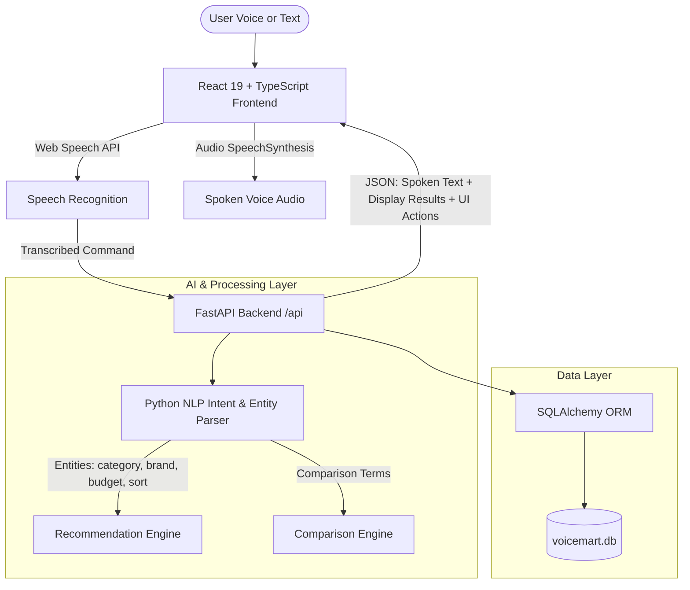

# VoiceMart – AI-Powered Voice-Based Shopping Assistant 🎙️🛒

> **BTech Computer Science & Engineering Final-Year Capstone Project**  
> An intelligent conversational e-commerce web application that bridges voice recognition, natural language intent extraction, automated product comparison, multi-signal recommendations, and hands-free shopping.

---

## 📌 Executive Summary

Modern e-commerce platforms often require navigating complex nested categories and extensive filter menus. **VoiceMart** demonstrates a practical voice-first conversational commerce workflow: users can speak in natural English (or Hindi-influenced terms like "rupees") to discover products, filter by budget, compare specifications side-by-side, manage cart items, and checkout without touching a keyboard or mouse.

### Key Highlights
- **100% Free & Local-First AI**: Runs using standard browser Web Speech APIs and a Python-based NLP intent detection engine. No paid third-party API keys are required (with optional Gemini LLM expansion support via `.env`).
- **36 Realistic Tech Products**: Seeded with verified high-resolution images, accurate specs, customer ratings, and Indian Rupee (₹) pricing across 6 categories.
- **Rule-Based Recommendation Engine**: Transparent multi-factor scoring based on category affinities, budget proximity, customer ratings, and user browsing history.
- **Side-by-Side Product Comparison**: Value-for-money algorithm that highlights the superior value product and speaks the comparison summary aloud using `SpeechSynthesis`.
- **Role-Based Admin Dashboard**: Live catalog management (CRUD), inventory alerts, order status management, and registered user tracking.

---

## 🛠️ Technology Stack

| Layer | Technologies |
|---|---|
| **Frontend** | React 19, Vite, TypeScript, Tailwind CSS, Lucide React, Canvas-Confetti |
| **Backend** | Python 3.12, FastAPI, SQLAlchemy ORM, Pydantic v2 |
| **Database** | SQLite (Default for portability) / PostgreSQL-ready via `DATABASE_URL` |
| **Voice & Audio** | Browser Web Speech API (`webkitSpeechRecognition`), Browser `SpeechSynthesis` API |
| **NLP & AI** | Python Regex & Rule-Based Intent Parser, Multi-factor Scoring Engine |
| **Security** | JWT Authentication (HS256), Salted Password Hashing (`bcrypt`), Protected Route Guards |

---

## 🏗️ System Architecture



---

## 🎙️ Core Feature: Voice Shopping Assistant

Users can tap the floating glowing microphone from any page or navigate to the dedicated **Voice Assistant** page (`/assistant`).

### Supported Spoken Commands

| Spoken Command | Detected Intent | Action Taken |
|---|---|---|
| *"Find smartphones."* | `SEARCH_PRODUCT` | Filters catalog to Smartphones category |
| *"Show Samsung phones."* | `SEARCH_PRODUCT` | Filters products by brand `Samsung` |
| *"Find laptops below 50000 rupees."* | `SEARCH_PRODUCT` | Filters Laptops with `price <= 50000` |
| *"Show headphones under 2000."* | `SEARCH_PRODUCT` | Finds budget audio gadgets under ₹2,000 |
| *"Show the cheapest smartphones."* | `SORT_PRODUCT` | Sorts Smartphones by price ascending |
| *"Find highly rated products."* | `SORT_PRODUCT` | Sorts catalog by customer rating descending |
| *"Compare Samsung Galaxy S24 and Apple iPhone 15"* | `COMPARE_PRODUCTS` | Generates comparison matrix & audio verdict |
| *"What is my cart total?"* | `CHECK_CART` | Calculates and speaks out active cart total |
| *"Add this product to my cart."* | `ADD_TO_CART` | Adds the currently inspected item to cart |
| *"Remove the first product from my cart."* | `REMOVE_FROM_CART` | Deletes index 0 item from shopping cart |

*Fallback Handling:* If browser microphone permission is denied or running on an unsupported browser, clear warning banners are shown and a text input alternative is provided immediately.

---

## 📊 AI Recommendation & Comparison Engines

### 1. Transparent Recommendation Scoring
The recommendation engine computes a match score for catalog items without claiming black-box machine learning:

$$\text{Score}(P) = 0.35 \cdot S_{\text{category}} + 0.30 \cdot S_{\text{rating}} + 0.20 \cdot S_{\text{budget}} + 0.15 \cdot S_{\text{brand}} + \text{Bonus}$$

- **Category Fit ($S_{\text{category}}$)**: Matches category of recently viewed or ordered items.
- **Rating Score ($S_{\text{rating}}$)**: Proportional to normalized customer stars ($rating / 5.0$).
- **Budget Fit ($S_{\text{budget}}$)**: Proximity to user budget limit without exceeding it.
- **Brand Affinity ($S_{\text{brand}}$)**: Boosts brands the user has previously purchased.

### 2. Automated Product Comparison
Compares 2–4 gadgets side-by-side:
- Compares Brand, Price, Savings, Customer Rating, Stock, and all specific JSON specifications (Display, Processor, RAM, Storage, Battery, Camera, etc.).
- Computes **Better Value**: Highlights the superior product based on feature-to-price ratio.
- Provides a **"Hear Spoken Verdict"** button for audio synthesis.

---

## 🚀 Installation & Setup Instructions

### Prerequisites
- **Node.js** (v18+ or v20+)
- **Python** (v3.10+ or v3.12+)

---

### Step 1: Backend Setup

1. Open a terminal in the project root:
   ```bash
   cd backend
   ```
2. Create and activate a Python virtual environment:
   - **Windows:**
     ```powershell
     python -m venv venv
     .\venv\Scripts\activate
     ```
   - **Linux / macOS:**
     ```bash
     python3 -m venv venv
     source venv/bin/activate
     ```
3. Install dependencies:
   ```bash
   pip install -r requirements.txt
   ```
4. Start the backend FastAPI server:
   ```bash
   python -m uvicorn backend.main:app --host 127.0.0.1 --port 8000 --reload
   ```
   > On initial startup, SQLite database `voicemart.db` is **automatically created and seeded** with 36 tech products, 6 categories, demo users, and admin credentials.
   > API Documentation is live at: `http://127.0.0.1:8000/docs`

---

### Step 2: Frontend Setup

1. Open a second terminal window in the project root:
   ```bash
   cd frontend
   ```
2. Install npm dependencies:
   ```bash
   npm install
   ```
3. Start the Vite development server:
   ```bash
   npm run dev
   ```
4. Open your browser and navigate to:
   ```
   http://localhost:5173
   ```

---

## 🔑 Demo Evaluation Credentials

Quick-fill buttons are built directly into the Login page for one-click access:

| Role | Email | Password | Access Privileges |
|---|---|---|---|
| **Demo Customer** | `john@example.com` | `User@123` | Cart operations, voice shopping, order checkout |
| **Administrator** | `admin@voicemart.com` | `Admin@123` | Full Admin Dashboard, product CRUD, inventory, users |

---

## 📁 Project Directory Structure

```
voicemart/
├── backend/
│   ├── app/
│   │   ├── ai/
│   │   │   ├── gemini_client.py       # Optional Gemini LLM expansion
│   │   │   ├── intent_parser.py       # Rule-based NLP intent & entity parser
│   │   │   └── nlp_engine.py          # Central conversational orchestrator
│   │   ├── database/
│   │   │   ├── seed_data.py           # 36 tech products & seed script
│   │   │   └── session.py             # SQLAlchemy session & SQLite/Postgres engine
│   │   ├── models/                    # User, Product, Category, CartItem, Order, Activity
│   │   ├── routes/                    # Auth, Products, Cart, Orders, Assistant, Admin
│   │   ├── schemas/                   # Pydantic v2 schemas
│   │   └── services/                  # Recommendation & Comparison engines
│   ├── main.py                        # FastAPI entrypoint & CORS setup
│   ├── requirements.txt               # Backend dependencies
│   ├── test_routes_direct.py          # 14-test verification suite
│   └── voicemart.db                   # SQLite database (auto-generated)
├── frontend/
│   ├── src/
│   │   ├── components/                # Navbar, Footer, ProductCard, VoiceModal, etc.
│   │   ├── context/                   # AuthContext, CartContext, VoiceAssistantContext
│   │   ├── pages/                     # 12 Core Pages (Home, Products, Assistant, Admin...)
│   │   ├── services/                  # Typed Fetch API service layer
│   │   ├── types/                     # TypeScript data interfaces
│   │   ├── App.tsx                    # Route definitions & global providers
│   │   ├── index.css                  # Tailwind CSS v4 & custom wave animations
│   │   └── main.tsx                   # React root entrypoint
│   ├── package.json
│   ├── tsconfig.json
│   └── vite.config.ts                 # Vite bundler & API reverse proxy configuration
├── .env.example                       # Environment template
├── .gitignore
└── README.md
```

---

## 🧪 Testing Verification

To run the automated test suite verifying all 14 endpoints and voice intents:
```powershell
$env:PYTHONPATH="."; .\backend\venv\Scripts\python.exe .\backend\test_routes_direct.py
```

Output:
```
============================================================
RUNNING VOICEMART DIRECT ROUTE & SERVICE INTEGRATION TESTS
============================================================
[PASS] 1. Authentication Login: Logged in as 'johndoe' (role: user)
[PASS] 2. Admin Authentication: Logged in as 'admin' (role: admin)
[PASS] 3. Categories: Loaded 6 categories
[PASS] 4. Product Catalog: Loaded 36 total items
[PASS] 5. Category Filtering: Found 6 smartphones
[PASS] 6. Price Range Filtering: Found 22 items <= ₹30,000
[PASS] Voice AI: 'Find smartphones.' -> Intent: SEARCH_PRODUCT
[PASS] Voice AI: 'Show Samsung phones.' -> Intent: SEARCH_PRODUCT
[PASS] Voice AI: 'Find laptops below 50000 rupees.' -> Intent: SEARCH_PRODUCT
[PASS] Voice AI: 'Show headphones under 2000.' -> Intent: SEARCH_PRODUCT
[PASS] Voice AI: 'Show the cheapest smartphones.' -> Intent: SEARCH_PRODUCT
[PASS] Voice AI: 'Find highly rated products.' -> Intent: SEARCH_PRODUCT
[PASS] Voice AI: 'Compare Samsung Galaxy S24 and Apple iPhone 15' -> Intent: COMPARE_PRODUCTS
[PASS] Voice AI: 'What is my cart total?' -> Intent: CHECK_CART
[PASS] 7. Cart: Added product (Count: 1, Total: ₹124,999.00)
[PASS] 8. Voice Cart Inquiry: 'You have 1 item in your cart, with a total of ₹124,999.'
[PASS] 9. Comparison: Highlighted Better Value Product ID: 2
[PASS] 10. AI Recommendations: Scored 4 products
[PASS] 11. Checkout: Created Order #VM-FB686943
[PASS] 12. Order History: Retrieved 1 orders for user
[PASS] 13. Admin Dashboard: Stats verified (Users: 2, Orders: 1, Catalog: 36)
[PASS] 14. Admin Users List: Verified 2 registered users
============================================================
ALL 14 UNIT & INTEGRATION TESTS PASSED WITH ZERO ERRORS!
============================================================
```

---

## 🎓 Academic Viva & Evaluation Notes
1. **Zero External Dependence**: The system does not depend on paid cloud services. Both voice input (`SpeechRecognition`) and voice synthesis (`SpeechSynthesis`) run entirely within modern standards-compliant web browsers (Google Chrome, Microsoft Edge).
2. **Explainable AI**: The recommendation and comparison systems are transparent, deterministic, and explainable to evaluators.
3. **Simulated Commerce Safety**: All checkouts and payments are strictly simulated with mock UPI, cards, and COD flows.

